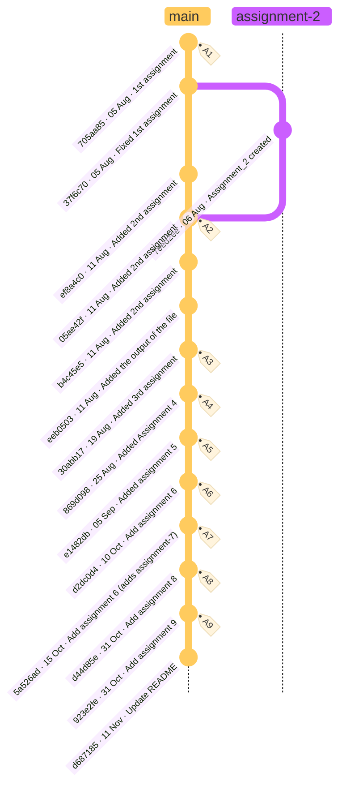

# UCS420 – Lab Assignments

Lab assignments for **UCS420**, written in Python as Jupyter notebooks.

**Student:** Vandit Gupta · **Roll No:** 1024170307

---

## 📚 Assignments

| # | Topic | Notebook | Files |
|:-:|-------|----------|-------|
| 1 | Python basics: printing, variables, arithmetic, string concatenation | [Assignment_1.ipynb](Assignment_1.ipynb) | – |
| 2 | Lists, tuples, sets and the `random` module | [Assignment2.ipynb](Assignment2.ipynb) | – |
| 3 | Pandas DataFrames: creating, indexing and working with CSV data | [UCS420_Assignment_3.ipynb](assignment-3/UCS420_Assignment_3.ipynb) | [Iris.csv](assignment-3/Iris.csv) · [employees.csv](assignment-3/employees.csv) · [employee_new.csv](assignment-3/employee_new.csv) |
| 4 | FAQ dataset with Pandas: keyword scoring, filtering and updating CSVs | [Assignment_4.ipynb](assignment-4/Assignment_4.ipynb) | [faq_data.csv](assignment-4/1024170307_faq_data.csv) |
| 5 | NumPy fundamentals: array operations, flipping, element comparisons | [assignment-5.ipynb](assignment-5/assignment-5.ipynb) | – |
| 6 | NumPy applied: vectorised maths, aggregation, slicing and views | [assignment6.ipynb](assignment-6/assignment6.ipynb) | – |
| 7 | NLP text preprocessing with NLTK | [Assignment7.ipynb](assignment-7/Assignment7.ipynb) | [generated_dataset.csv](assignment-7/1024170307_generated_dataset.csv) |
| 8 | NLP: tokenisation, frequency analysis, sentiment (TextBlob, VADER) and word clouds | [assignment8.ipynb](assignment-8/assignment8.ipynb) · [Q6](assignment-8/assignment8%286th_question%29.ipynb) | [positive_wordcloud.png](assignment-8/positive_wordcloud.png) |
| 9 | Computer vision with LandingAI predictions, Pillow and gTTS | [assignment9.ipynb](assignment-9/assignment9.ipynb) | – |

> Click a notebook to open it on GitHub, or open it in [Google Colab](https://colab.research.google.com/) / Jupyter to run it.

---

## 🛠️ Tech Stack

`Python` · `Jupyter / Colab` · `NumPy` · `Pandas` · `Matplotlib` · `NLTK` · `TextBlob` · `VADER` · `scikit-learn` · `WordCloud` · `Pillow` · `LandingAI` · `gTTS`

---

## 📁 Repository Structure

```
UCS420/
├── Assignment_1.ipynb
├── Assignment2.ipynb
├── assignment-3/   # Pandas + CSV datasets
├── assignment-4/   # FAQ data handling
├── assignment-5/   # NumPy basics
├── assignment-6/   # NumPy applied
├── assignment-7/   # NLP preprocessing
├── assignment-8/   # NLP + sentiment analysis
├── assignment-9/   # Computer vision (LandingAI)
└── readme.md
```

---

## 🌳 Commit History



### Contribution Graph

[](https://github.com/VanditGupta0)

See the full [commit history](https://github.com/VanditGupta0/UCS420/commits/main) on GitHub.

---

## 👤 Contributors

| Contributor | Role | Contributions |
|:-----------:|------|---------------|
| <a href="https://github.com/VanditGupta0"><br/><b>Vandit Gupta</b></a> | Author | All assignments (1–9), datasets and documentation |
